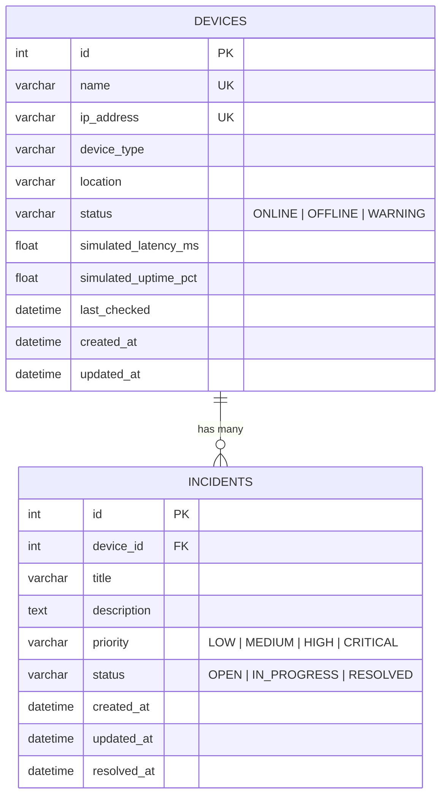
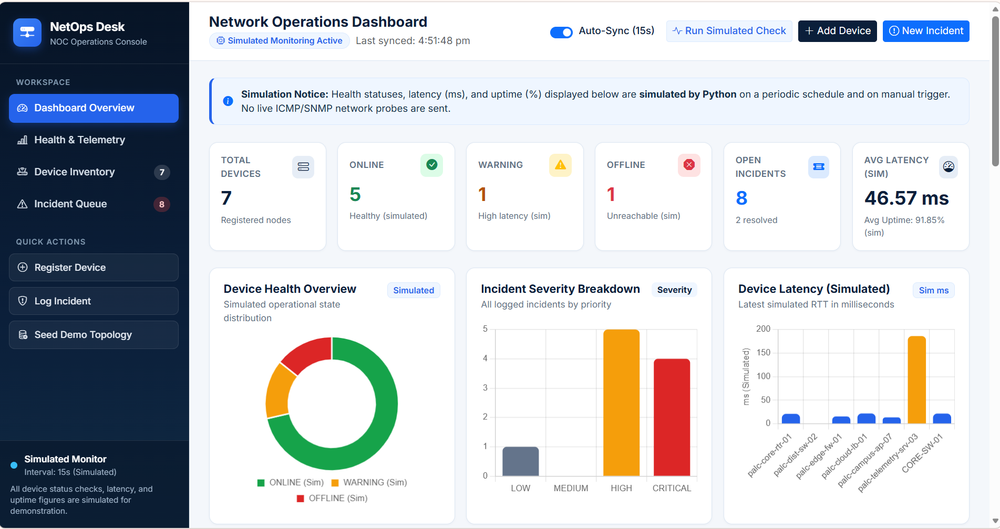
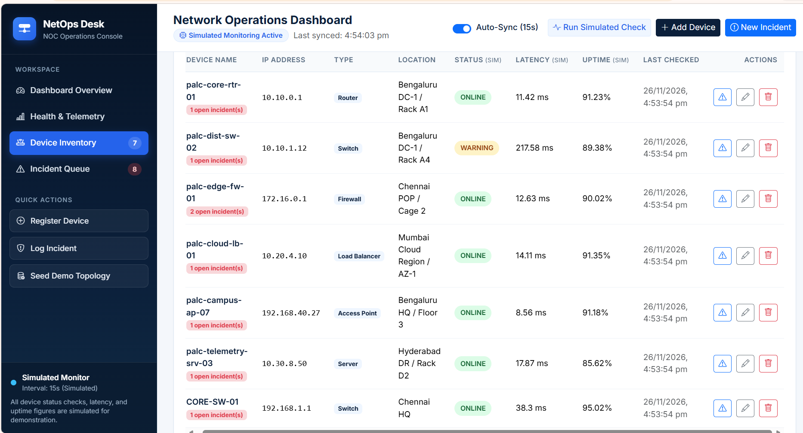
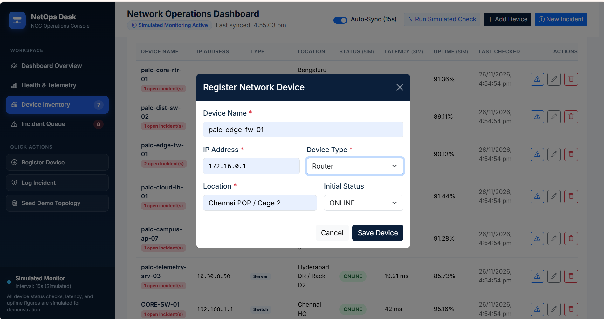
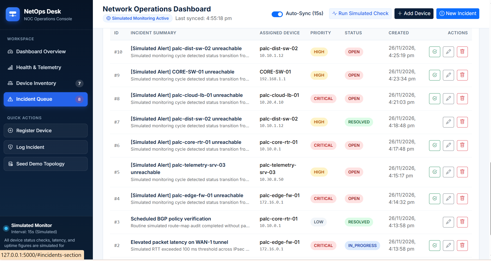
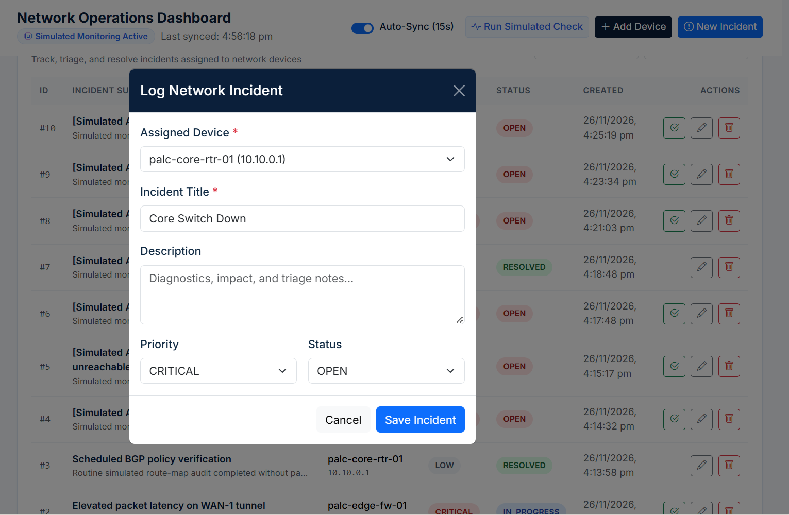

# NetOps Desk – Network Monitoring & Incident Management System

**NetOps Desk** is a full-stack Network Operations Center (NOC) web application built with **Python Flask**, **MySQL**, **Flask-SQLAlchemy**, and **Bootstrap 5**. It provides device inventory management, incident lifecycle tracking, RESTful JSON APIs, and a **simulated** network health monitoring engine for demonstrating network operations workflows.

> **Simulation Notice:** All device health checks, status transitions (`ONLINE` / `WARNING` / `OFFLINE`), latency (`ms`), and uptime (`%`) metrics are **simulated in Python** (`app/services/monitoring.py`) for demonstration purposes. NetOps Desk does **not** send real ICMP pings, SNMP queries, or live production probes.

---

## Key Features

- **NOC Operations Dashboard**
  - Real-time KPI summary cards: Total Devices, Online, Warning, Offline, Open Incidents, and Average Simulated Latency & Uptime.
  - Interactive **Chart.js** visualizations: Device Health Overview (Doughnut), Incident Severity Breakdown (Bar), and Simulated Device Latency (Bar).
  - Navy blue, white, and subtle blue responsive UI with collapsible sidebar and auto-sync toggle.
- **Device Inventory Management**
  - Full CRUD (`Add`, `View`, `Edit`, `Delete`) for Routers, Switches, Firewalls, Access Points, Servers, and Load Balancers.
  - Strict validation for unique hostnames, valid IPv4/IPv6 addresses (`ipaddress`), and allowed statuses.
  - Search and multi-criteria filtering by status and device type.
- **Simulated Network Monitoring Engine**
  - Background daemon scheduler (`MONITORING_INTERVAL_SECONDS`) and manual trigger (`POST /api/monitoring/run`).
  - Weighted state-transition model generating realistic simulated latency and uptime changes.
  - Automatic `[Simulated Alert]` incident creation when a device transitions to `OFFLINE` (deduplicated against open alerts).
- **Incident Management**
  - Create, assign to devices, triage (`OPEN` → `IN_PROGRESS` → `RESOLVED`), prioritize (`LOW`, `MEDIUM`, `HIGH`, `CRITICAL`), and quick-resolve incidents.
  - Automatic `resolved_at` timestamp tracking on resolution.
- **Automated Testing**
  - `pytest` suite covering SQLAlchemy models/constraints, REST API CRUD, error handling, validation, and simulated monitoring.

---

## Technology Stack

| Layer | Technology |
| :--- | :--- |
| **Backend** | Python 3.12, Flask 3, Flask-SQLAlchemy, PyMySQL |
| **Database** | MySQL 8.x (InnoDB) — with SQLite in-memory used for isolated `pytest` runs |
| **Frontend** | HTML5, CSS3, Bootstrap 5.3, Bootstrap Icons, Vanilla JavaScript (`fetch`), Chart.js 4 |
| **Configuration** | `python-dotenv` environment variables (zero hardcoded credentials) |
| **Testing** | `pytest` |

---

## Project Structure

```text
NetOps-Desk/
├── app/
│   ├── __init__.py            # Flask application factory, blueprint wiring, CLI commands
│   ├── config.py              # Env-driven Development, Testing, and Production configs
│   ├── extensions.py          # Shared SQLAlchemy instance
│   ├── models/
│   │   ├── __init__.py
│   │   ├── device.py          # Device table model & serialization
│   │   └── incident.py        # Incident table model & foreign key relation
│   ├── routes/
│   │   ├── __init__.py
│   │   ├── web.py             # Dashboard HTML view
│   │   ├── api_devices.py     # /api/devices CRUD & filtering endpoints
│   │   ├── api_incidents.py   # /api/incidents CRUD & resolve endpoints
│   │   └── api_dashboard.py   # /api/dashboard & /api/monitoring endpoints
│   ├── services/
│   │   ├── __init__.py
│   │   ├── monitoring.py      # Simulated health engine & background thread scheduler
│   │   ├── seeder.py          # Idempotent demo topology seeder
│   │   └── validation.py      # Payload & IPv4/IPv6 input validation helpers
│   ├── static/
│   │   ├── css/styles.css     # Navy/white/subtle-blue NOC theme
│   │   └── js/dashboard.js    # REST client, Chart.js rendering, modals & toasts
│   └── templates/
│       └── index.html         # Responsive NOC dashboard template
├── tests/
│   ├── conftest.py            # Isolated Flask test client & database fixtures
│   ├── test_models.py         # Model constraints & cascade delete tests
│   ├── test_devices_api.py    # Device REST API tests
│   ├── test_incidents_api.py  # Incident & dashboard REST API tests
│   ├── test_monitoring.py     # Simulated monitoring & seeder tests
│   └── test_web.py            # Dashboard HTML rendering test
├── .env.example               # Template environment configuration
├── .gitignore
├── requirements.txt
├── run.py                     # Local WSGI/dev entry point
├── schema.sql                 # Reference MySQL 8 DDL schema
└── README.md
```

---

## Local Setup Instructions

### 1. Clone & Create Virtual Environment

```powershell
git clone <your-repo-url>
cd NetOps-Desk
python -m venv .venv
.venv\Scripts\activate
pip install -r requirements.txt
```

*(On macOS/Linux, activate with `source .venv/bin/activate`.)*

### 2. Provision MySQL Database

Ensure MySQL 8.x is running locally, then create the database (or run `schema.sql`):

```sql
CREATE DATABASE IF NOT EXISTS netops_desk
  CHARACTER SET utf8mb4
  COLLATE utf8mb4_unicode_ci;
```

### 3. Configure Environment Variables

Copy `.env.example` to `.env` and fill in your local MySQL credentials (**never commit `.env`**):

```powershell
Copy-Item .env.example .env
```

Update `.env`:

```ini
FLASK_ENV=development
SECRET_KEY=replace-with-a-secure-random-string

DB_HOST=127.0.0.1
DB_PORT=3306
DB_USER=root
DB_PASSWORD=your_mysql_password
DB_NAME=netops_desk

MONITORING_ENABLED=true
MONITORING_INTERVAL_SECONDS=15
```

> **Quick Demo Without MySQL:** Set `USE_SQLITE_FALLBACK=true` in `.env` to run locally with a file-based SQLite database (`netops_desk_dev.db`).

### 4. Initialize Tables & Seed Demo Data

```powershell
.venv\Scripts\flask.exe --app run.py init-db
.venv\Scripts\flask.exe --app run.py seed-db
```

### 5. Run the Application

```powershell
.venv\Scripts\python.exe run.py
```

Open **http://127.0.0.1:5000** in your browser.

---

## Database Schema

NetOps Desk models a **one-to-many** relationship (`devices` 1 → N `incidents`) with foreign-key cascading (`ON DELETE CASCADE`) and database-level `CHECK` constraints.



See [schema.sql](schema.sql) for the full MySQL DDL script.

---

## REST API Documentation

All `/api/*` endpoints accept and return `application/json` with standard HTTP status codes (`200`, `201`, `400`, `404`, `409`).

### Health & Dashboard

| Method | Endpoint | Description |
| :--- | :--- | :--- |
| `GET` | `/api/health` | Service liveness check |
| `GET` | `/api/dashboard` | Aggregated device counts, incident breakdown, and simulation metadata |
| `POST` | `/api/monitoring/run` | Trigger an immediate simulated monitoring sweep |
| `POST` | `/api/monitoring/seed` | Idempotently seed sample network devices & incidents |

### Devices (`/api/devices`)

| Method | Endpoint | Description |
| :--- | :--- | :--- |
| `GET` | `/api/devices` | List devices (supports `?status=`, `?device_type=`, `?search=`) |
| `GET` | `/api/devices/<id>` | Get device details (supports `?include_incidents=true`) |
| `POST` | `/api/devices` | Register a new device (`201 Created` or `409 Conflict` on duplicate name/IP) |
| `PUT` | `/api/devices/<id>` | Update device fields or status |
| `DELETE` | `/api/devices/<id>` | Delete a device and cascade-delete its incidents |

**Example `POST /api/devices` Request:**
```json
{
  "name": "palc-core-rtr-02",
  "ip_address": "10.10.0.2",
  "device_type": "Router",
  "location": "Bengaluru DC-1 / Rack A2",
  "status": "ONLINE"
}
```

### Incidents (`/api/incidents`)

| Method | Endpoint | Description |
| :--- | :--- | :--- |
| `GET` | `/api/incidents` | List incidents newest first (supports `?status=`, `?priority=`, `?device_id=`) |
| `GET` | `/api/incidents/<id>` | Get single incident details |
| `POST` | `/api/incidents` | Create an incident linked to an existing `device_id` |
| `PUT` | `/api/incidents/<id>` | Update incident title, description, priority, device, or status |
| `POST` / `PATCH` | `/api/incidents/<id>/resolve` | Mark an incident `RESOLVED` and record `resolved_at` |
| `DELETE` | `/api/incidents/<id>` | Delete an incident |

**Example `POST /api/incidents` Request:**
```json
{
  "device_id": 1,
  "title": "BGP Neighbor Flap on Gi0/1",
  "description": "Packet loss observed on primary transit interface.",
  "priority": "CRITICAL",
  "status": "OPEN"
}
```

---

## Running Automated Tests

```powershell
.venv\Scripts\python.exe -m pytest -v
```

Tests run against an isolated in-memory SQLite database via `TestingConfig` (`app/config.py`) so your local MySQL data is never modified during testing.

---

## Screenshots
---

## Screenshots

### Dashboard Overview

Provides a real-time summary of device status, open incidents, simulated latency, uptime metrics, and monitoring insights.



---

### Device Inventory

Manage network devices including routers, switches, firewalls, servers, and load balancers with filtering and search capabilities.



---

### Add Device

Register new devices with hostname, IP address, device type, location, and operational status validation.



---

### Incident Queue

Monitor and manage network incidents with severity levels, status tracking, and device associations.



---

### Create Incident

Log and triage incidents through the NOC workflow with priority classification and incident assignment.


